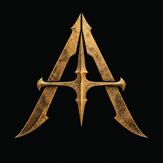
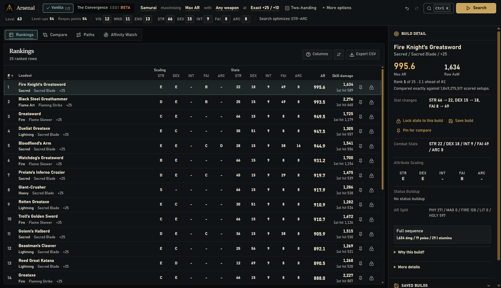
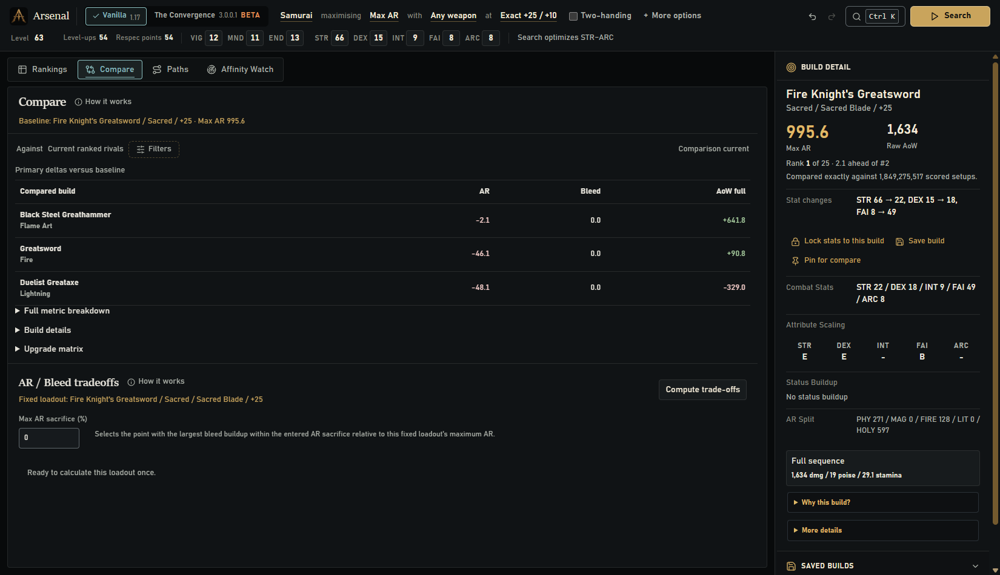
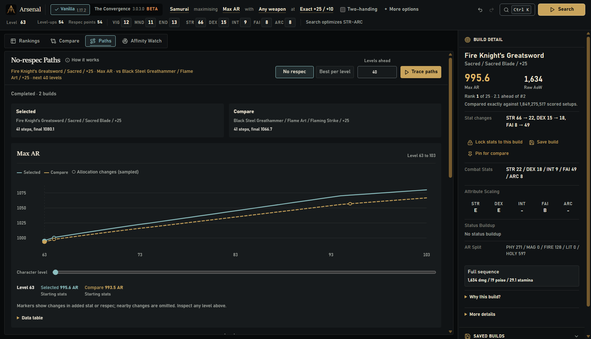
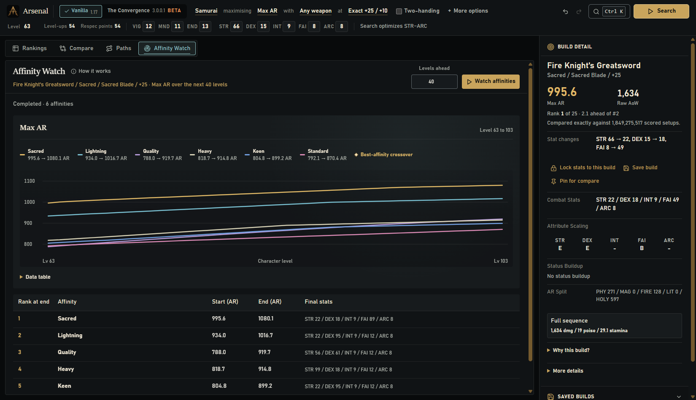

<div align="center">



# Tarnished’s Arsenal

**Find your weapon. Compare your options. Plan your next levels.**

A Windows and Linux (x64) desktop build optimizer for Elden Ring. Search weapons, affinities,
Ashes of War, upgrades, and combat stats, then carry a selected build into
comparisons and progression previews.

[](https://github.com/FueledByRedBull/tarnisheds-arsenal/releases/latest)

[](https://github.com/FueledByRedBull/tarnisheds-arsenal/actions/workflows/ci.yml)
[](https://github.com/FueledByRedBull/tarnisheds-arsenal/releases/latest)
[](https://github.com/FueledByRedBull/tarnisheds-arsenal/releases)
[](LICENSE)

[](#download)
[](docs/model-reference.md)
[](#convergence-beta)
[](core/er_optimizer_core)
[](apps/desktop/src-tauri)
[](apps/desktop/src)

[What’s new in v0.21.0](docs/release-notes/v0.21.0.md)
· [Your first build](#your-first-build)
· [Documentation](#documentation)

</div>

Each Rankings row shows the loadout, weapon scaling, combat stats, AR, and skill
damage, with the selected build’s full breakdown on the right. **Columns** explains
each one.



## Download

Choose an asset from the [latest published release](https://github.com/FueledByRedBull/tarnisheds-arsenal/releases/latest).
The [v0.21.0 notes](docs/release-notes/v0.21.0.md) include versioned downloads,
calculation changes, and verification limits.

| Choose | Best for |
| --- | --- |
| **Installer** (`.msi`) | Normal installation, with WebView2 setup if needed |
| **Portable app** (`.exe`) | Run directly with WebView2 already installed |
| **Archive** (`.zip`) | Keep or transfer the portable app and release documentation |
| **Debian/Ubuntu** (`.deb`) | Install on Linux; the package manager pulls in WebKitGTK |
| **Fedora/openSUSE** (`.rpm`) | Install on RPM-based Linux; the package manager pulls in WebKitGTK |
| **AppImage** (`.AppImage`) | Run on other Linux distributions without installing |

> [!TIP]
> No game files needed. Every package includes the Vanilla **1.17.2** and Convergence
> **3.0.3.0** snapshots, so no adjacent data folder, game installation,
> `regulation.bin`, or source workbook is required.

Linux packages are new and tested on Ubuntu 24.04 only; the `.rpm` is built but has
not been launched. Each release includes SHA-256 checksums for the installer, portable app, and ZIP,
a separate checksum file for the Linux packages, and a build report identifying
its source and data. The ZIP contains the portable
app with the license and third-party notices; the MSI’s WebView2 bootstrapper
needs internet access if that runtime is missing.

## Your first build

1. Choose **Vanilla**. The query line at the top reads as one sentence: click
   your starting class to change it, and type your stats into the boxed fields of
   the ribbon below. As the ribbon says, Search optimizes STR–ARC: it moves STR,
   DEX, INT, FAI, and ARC within your level, while VIG, MND, and END stay as entered.
2. Click the objective (such as **Max AR**), the loadout, the upgrades, or any
   other part of the query to edit it; open fields allow all legal choices.
   **+ More options** holds DLC scaling, the result count and grouping, and stat
   locks and minimums. Press **Ctrl+K** to type a change instead, such as
   `str 40`, `uchigatana`, `+20`, `top 10`, or `level 60` to plan where your next
   levels go.
3. Press **Search**, then select a row to inspect its damage, scaling, and stats.
   Build Detail shows how far the top result leads the next one, how many scored
   setups the search compared, and which of your entered stats the build changes.
   **More details** adds weapon data, the stat budget, and the model’s coverage
   notes.
4. Pin another result for **Compare** (or press **P** on a focused row), trace
   future levels in **Paths**, or explore affinity crossover points in
   **Affinity Watch**. These workspaces unlock once a current result is selected;
   the tab bar says what is missing.

Save builds from **Saved Builds**, folded under Build Detail, or export rankings
with **Export CSV**, which asks for 25, 100, 500, or 2,000 rows. Each game profile
keeps its own query, including across restarts: switch away and back, or reopen
the app, and it is restored, ready to search again.
The query line shows the assumptions behind the rankings; changed inputs mark
old results as stale. **Ctrl+Z** undoes recent query changes (up to 50) outside
text fields; switching profile starts a new history. After
**Update Results**, each rank shows how far that loadout moved and how its score
changed. Click **AR**, **Skill damage**, or the objective column to sort without
losing the rank, and press **?** for every shortcut. Convergence has its own
classes and [coverage limits](#convergence-beta).

### Saved builds and recovery

Saved Builds includes **Backup and recovery**. **Export all builds** backs up
readable builds across profiles. Select a backup file to preview its contents,
then restore as new copies; existing builds are kept. A backup file holds up to
500 builds and 10 MiB, and a restore is refused if your existing and restored
builds together would exceed 500. Existing schema 1/2 builds remain readable.

If the saved-build list is damaged or incomplete, scan it and review the recovery
count and issues. Recovery rebuilds the list from readable records, preserves the
original index on this device, and leaves unreadable records untouched. Exported
backups exclude unreadable records. If storage access or space is unavailable,
the app reports the failure instead of replacing your library with an empty one.

**Why this build?** explains the selected result's objective, its lead over the
next result and the largest AR difference behind it, its damage split, and active
constraints. **Stat changes** lists each combat stat the build sets differently
from the stats you entered. These are calculation summaries, not estimates of
each stat's causal damage contribution.

## Interface

| Workspace | The question it answers |
| --- | --- |
| **Rankings** | What wins within my level, upgrade caps, stat locks, and filters? |
| **Compare** | How does another loadout compare with the selected baseline? |
| **Paths** | Which stat comes next on a no-respec path, or what wins with a respec? |
| **Affinity Watch** | When does one affinity overtake another at future levels? |

Compare, Paths, and Affinity Watch each explain their method under **How it works**
below their title.

<details>
<summary><strong>Compare — see the differences against your baseline</strong></summary>

Pinned loadouts keep their weapon, affinity, and skill. Their stats and upgrades
are reoptimized for the current budget. Compare holds up to eight pins and refuses
a ninth; loading a saved build replaces them only if that build carries its own.
Active comparison filters appear as removable chips; **Filters** holds every
option, and **Use ranked rivals** returns to the default comparison. The delta
table answers the comparison; open **Build details** for each loadout's full card,
or **Upgrade matrix** to see how each develops across upgrade levels.

**AR / Bleed tradeoffs** keeps the selected weapon, affinity, skill, upgrade,
level budget, stat floors/locks, and handling fixed. Press **Compute trade-offs**
for its complete frontier, then inspect maximum AR, maximum bleed, or the most
bleed within a stated AR loss. AR loss is measured against that fixed loadout's
maximum AR, not the highest AR across all weapons.
The 1%, 3%, and 5% choices are sacrifice limits, not bleed-proc breakpoints. An
all-options table and optional plot show the same achievable allocations.
One point means one non-dominated AR/bleed outcome; other allocations may tie.
With all combat stats locked, there is no allocation to vary.
Use **Use exact allocation** to lock its equipment, upgrade, and combat stats in
Rankings; the existing Build Detail and save actions then use those exact stats.

Compare needs fresh Rankings results. If you change the search inputs, update
Rankings before comparing again.



</details>

<details>
<summary><strong>Paths — follow both builds level by level</strong></summary>

No-respec paths optimize a terminal allocation, then add each level's point where
it helps most toward that target, so the path never needs a respec.
**Best per level** instead finds the best allocation at each level and marks the
levels that require a respec. Two lanes share one paginated level table. The chart
uses labeled axes and sparse breakpoint markers; hover a point or use the
**Character level** slider to read that level's values.



</details>

<details>
<summary><strong>Affinity Watch — find the crossover points</strong></summary>

Keep the weapon, skill, and upgrade fixed while each legal affinity optimizes its
combat stats at each future level. Exact stat locks are ignored; minimums remain.



</details>

## What the numbers mean

Rankings compare modeled attack rating, status buildup, or raw skill damage under
your chosen constraints.

> [!IMPORTANT]
> Enemy defenses and status-proc damage are not modeled. Status values describe
> buildup, not the damage from triggering a proc.

Some skill interactions remain unsupported; warnings in Build Detail identify
those limits.

Results use exact arithmetic for ranking and rounded numbers for display. This
avoids intermediate rounding deciding close winners; it does not certify every
formula against the game. A loaded profile has passed its data integrity checks,
which does not mean every mechanic is modeled; the header stays quiet when it is
healthy. **Model coverage and assumptions** under Build Detail’s **More details**
lists what the numbers leave out.

See the [model reference](docs/model-reference.md) for supported objectives, skill
effects, profile rules, and known differences from other calculators.

### Convergence beta

> [!NOTE]
> Convergence 3.0.3.0 is experimental. Its AR and status are checked against the
> mod's regulation and a pinned external calculator, and its Ash legality against
> the regulation's raw permissions. AoW damage is read from the mod's skill
> animations and has no external check. None of it is measured in game.

The header marks it **Experimental model**; open that label for its coverage
notes. Choose one of the mod's 29 starting classes, such as **Stormcaller** or
**Retainer (Alt)**, named as the game's menu shows them, and plan by Rune Level as in Vanilla: class optimization, Compare,
Paths, and Affinity Watch all work. **Custom stats** remains in the class list:
it evaluates the exact stats you enter, their total is not a Rune Level, and the
analysis workspaces stay locked while it is selected. Builds saved with Custom
stats load and solve as before.

The profile supports melee weapon AR and upgrades through `+15`. Status buildup
is fixed: the mod gives weapons a flat status correction curve, so Arcane and
upgrades do not raise it. AoW damage and routes come from the mod's own skill
animations; bow skills, buff states and hold loops stay unmodeled, and the
[coverage table](docs/model-reference.md#convergence) lists which Ashes resolve
damage. Ammunition AR is unavailable.

Vanilla rules, classes, and missing damage tables are never substituted into the
mod profile. See [Convergence coverage](docs/model-reference.md#convergence).

## Documentation

Choose a guide for the task at hand:

| I want to… | Read |
| --- | --- |
| See what changed in **v0.21.0** | [Release notes](docs/release-notes/v0.21.0.md) · [All versions](docs/release-notes/README.md) |
| Understand supported mechanics and limitations | [Model reference](docs/model-reference.md) |
| Find components and trace a calculation | [Optimizer overview](docs/design/optimizer-overview.md) |
| Inspect the exact ranking contract and proof | [Optimizer mathematics](docs/design/optimizer-math.md) |
| Work on jobs, caches, profiles, or saved builds | [Runtime invariants](docs/architecture/runtime-invariants.md) |
| Measure performance or native responsiveness | [Performance guide](docs/performance.md) |
| Refresh a game-data snapshot | [Extraction guide](tools/phase1/README.md) |
| Prepare and publish a release | [Release guide](docs/releasing.md) |

## For contributors

[Report a bug](https://github.com/FueledByRedBull/tarnisheds-arsenal/issues) with the
app version, game profile, reproduction steps, and expected versus actual results.
Use [private vulnerability reporting](SECURITY.md) for security issues.

Open **Report a problem** at the bottom of Build Detail and use
**Preview reproduction report** to review and download a report; the
[security policy](SECURITY.md#reproduction-reports) lists what it contains and omits.

Submit focused pull requests against `main`, explain the problem and checks run,
and add a regression for behavior changes. Keep raw game files, credentials,
build output, and local working notes out of commits.

<details>
<summary><strong>Build and validate locally</strong></summary>

Use the repository’s pinned toolchains: **Rust 1.97.0**, **Node.js 22.23.1**, and
**Python 3.12.10**. Windows desktop development also needs the
[Tauri prerequisites](https://v2.tauri.app/start/prerequisites/#windows), including
Microsoft C++ Build Tools and WebView2; Linux development needs the
[Linux prerequisites](https://v2.tauri.app/start/prerequisites/#linux). Rust’s `clippy` and `rustfmt` components
are declared in `rust-toolchain.toml`.

From the repository root, start the native desktop:

```powershell
cd apps/desktop
npm ci
npm run tauri dev
```

Tauri starts Vite automatically. `npm run dev` is the frontend-only alternative
and uses preview data in the browser.

Run core, backend, and data checks from the **repository root**:

```powershell
python -m pip install --require-hashes -r requirements-validation.txt
cargo test --locked --manifest-path core/er_optimizer_core/Cargo.toml
cargo test --locked --manifest-path apps/desktop/src-tauri/Cargo.toml
python tools/phase4/validate_phase4.py
```

Run frontend checks from **`apps/desktop`**:

```powershell
npm run lint
npm run test:contracts
npm test
npm run build
npx playwright install chromium
npm run test:e2e
```

The frontend uses React 19.3 with the modern JSX transform. Linting applies the
React Hooks plugin's latest recommended rules, including the React Compiler checks,
and type-checks the browser tests. The contract check compares all public Rust DTO
field shapes and enums with TypeScript, including the request types used by the
API adapter, and checks that every native command is registered, allowed and
called with matching argument names. It does not replace native value validation
or serialization tests. The same command also tests the lint configuration and the
native responsiveness metrics. CI and full package validation run both checks.

The full checks and setup live in [CI](.github/workflows/ci.yml). The core is in
`core/er_optimizer_core`; the desktop is in `apps/desktop`. Historical phase names
remain for extraction (`tools/phase1`) and validation/packaging (`tools/phase4`).

</details>

## License

Code is available under the [MIT License](LICENSE). Fan-made tooling, unaffiliated
with FromSoftware or Bandai Namco Entertainment; it does not distribute Elden Ring.
Third-party data and software credits are in [NOTICE](NOTICE).
